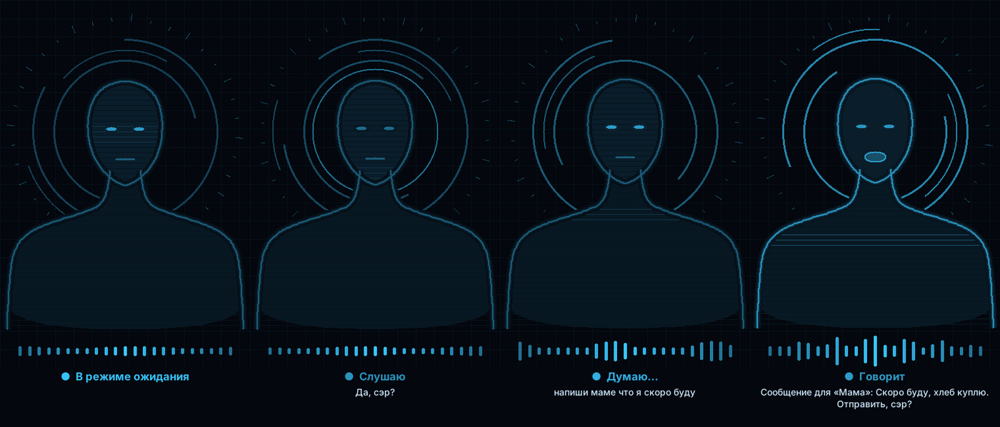

# Джарвис — голосовое управление компьютером (Windows 10/11)

Управляет компьютером голосом без клавиатуры: открывает программы и сайты, печатает под диктовку,
нажимает клавиши, отвечает на вопросы с помощью ИИ, читает Telegram, отвечает на сообщения
(только после вашего «да»), открывает чат для звонка и докладывает обстановку.

Всё бесплатно: речь распознаётся без интернета (Vosk), ИИ работает на вашем компьютере (Ollama + Qwen 2.5).

## Установка (всё делается мышкой)

1. Откройте страницу репозитория на GitHub, переключите ветку на `claude/confident-brown-r8uh4o`,
   нажмите зелёную кнопку **Code → Download ZIP**.
2. Откройте скачанный ZIP → правой кнопкой → **Извлечь всё** → **Извлечь**.
3. Зайдите в папку `jarvis` и дважды щёлкните **install.bat**.
   Если Windows пишет «Система Windows защитила ваш компьютер» — нажмите **Подробнее → Выполнить в любом случае**.
4. Ждите 10–40 минут: скачаются Python, Ollama, модель речи (45 МБ) и модель ИИ (2–5 ГБ).
   Если Windows спросит разрешение на установку — нажмите **Да**.
5. В конце Джарвис запустится сам и скажет «Джарвис на связи». На рабочем столе появится ярлык
   «Джарвис», и он будет запускаться при включении компьютера.

Если что-то нужно напечатать при установке — используйте экранную клавиатуру:
Пуск → Параметры → Специальные возможности → Клавиатура → Экранная клавиатура.

## Подключение Telegram (один раз)

1. Дважды щёлкните **setup_telegram.bat**.
2. Откроется сайт my.telegram.org: войдите по номеру, нажмите **API development tools**,
   впишите любое название (например `Jarvis`), нажмите **Create application**.
3. Скопируйте мышкой `api_id` и `api_hash` и вставьте в чёрное окно (правый щелчок = вставить), потом нажмите Enter.
4. Введите номер телефона и код из Telegram (экранной клавиатурой).
5. Перезапустите Джарвиса ярлыком на рабочем столе.

Данные входа хранятся только на вашем компьютере (файл `telegram.session`). Никому не отправляйте этот файл.

## Как говорить

Начинайте с **«Джарвис»** и говорите **своими словами**, как человеку: «а можешь открыть мне ютуб»,
«сделай чуть потише», «прокрути страницу вниз», «напиши маме, что я задержусь». Вежливые и лишние
слова Джарвис пропускает, разные формы слов понимает. Если ИИ подключён, он понимает вообще любые
просьбы и вопросы. Без ИИ вопросы («что такое…», «какая погода…») он ищет в интернете.

**Подсказки.** Без ИИ слева от Джарвиса само открывается окно «Что можно сказать»: примеры фраз и
строка «Вы сказали: … ✓ понял / ✗ не понял». С ИИ его открывает «что ты умеешь», закрывает «скрой подсказки».

**Обращение как к Siri или Алисе.** «Привет, Джарвис, открой ютуб», «Окей, Джарвис, сделай потише»,
«Эй, Джарвис, который час» — одной фразой. Или просто «Джарвис», он ответит «Слушаю», и говорите дальше.

**Разрешение перед важным.** Всё, что меняет компьютер или пишет от вашего имени, Джарвис делает только после
«да»: отправку сообщений в Telegram, запуск файлов и программ, смену темы Windows, выключение и перезагрузку.

**Настройки Windows голосом.** «Открой настройки Wi-Fi / Bluetooth / звука / экрана / обновлений / батареи /
мыши / языка / уведомлений», «сделай ярче», «темнее», «яркость на 50», «включи тёмную тему».

**Мышка.** Джарвис следит глазами за курсором. Скажите «следи за мышкой» — и после щелчка по окну,
ярлыку или кнопке на панели задач он назовёт объект и предложит действие («Telegram. Свернуть, развернуть
или закрыть?»). Отвечайте «сверни», «разверни», «закрой» (после «да»), «открой». Выключить: «не следи за мышкой».

**Переходы между режимами.** Смена вида идёт с анимацией: волшебный дым (Шрек ↔ панда), цифровой распад
(в командный центр и обратно), акварель (из командного центра в панду).

**Файлы и папки голосом.** «Открой файл отчёт», «запусти файл setup», «открой документ договор»,
«открой папку проекты». Джарвис ищет на рабочем столе, в документах, загрузках и на дисках D, E…;
если нашлось несколько — перечислит и спросит номер.

**Вид:** «переключись в режим панды», «переключись в режим Шрека» (волшебное зеркало),
«переключись в командный центр» (голова в трубе).

После ответа Джарвис 12 секунд слушает без обращения — можно говорить подряд. «Спасибо» заканчивает разговор.

| Что сказать | Что произойдёт |
|---|---|
| Джарвис, открой хром / телеграм / проводник / блокнот | откроет программу (любую — через Пуск) |
| Джарвис, открой ютуб / почту / вконтакте | откроет сайт |
| Найди рецепт борща / найди на ютубе лофи музыку | поиск |
| Напечатай привет мир | напечатает текст в активное окно |
| **Диктовка** … «стоп диктовка» | печатает всё, что вы говорите. Знаки: «точка», «запятая», «вопросительный знак», «новая строка» |
| Нажми энтер / пробел / удали / таб / эскейп | клавиши |
| Скопируй, вставь, выдели всё, отмени, сохрани | Ctrl+C / V / A / Z / S |
| Новая вкладка, закрой вкладку, обнови, назад | браузер |
| Листай вниз / вверх, ниже, в самый низ | прокрутка |
| Клик / двойной клик / правый клик | щелчок там, где стоит мышь |
| Закрой окно, переключи окно, сверни всё | окна |
| Громче, тише, выключи звук, пауза, следующий трек | звук и музыка |
| Который час, какое сегодня число, скриншот | |
| **Отчёт** | время, загрузка ПК, батарея, диск, непрочитанные в Telegram |
| **Сообщения** | прочитает непрочитанные сообщения Telegram |
| Ответь скоро буду | ответит последнему собеседнику (после «да») |
| Придумай ответ | ИИ сочинит ответ по переписке, прочитает его, отправит после «да» |
| Напиши маме, что я задержусь | ИИ найдёт контакт и составит сообщение, отправит после «да» |
| Позвони маме | откроет чат с этим контактом в Telegram |
| Заблокируй компьютер / выключи компьютер / перезагрузи | выключение — только после «да» |
| Что такое …? / любой вопрос | ответит голосом с помощью ИИ |
| Джарвис, выход | закрыть Джарвиса |

Новые личные сообщения Telegram Джарвис зачитывает сам, сразу после прихода.

## Характер, голоса и окно с силуэтом

Джарвис говорит как вежливый британский дворецкий и обращается к вам «сэр»
(обращение меняется в `config.json`, поле `address`, например `"шеф"` или пустое `""`).

**Запуск.** При включении окно Джарвиса открывается крупно по центру экрана: сцена проявляется
из темноты, поверх идёт загрузка систем с настоящими проверками (распознавание речи, голос, ИИ,
Telegram). Потом Джарвис здоровается, и окно плавно уезжает в правый нижний угол. Без заставки:
`"intro": false` в `config.json`.

Пока Джарвис работает, в углу экрана открывается объёмное (3D) окно. Есть две сцены:

- **Волшебное зеркало** (по умолчанию). Резная золотая рама с бусинами, завитками и камнями,
  в глубине стекла клубится дымка, из неё проступает светлое лицо-маска. Когда Джарвис молчит,
  лицо почти растворяется. Когда слушает, проступает ясно. Когда думает, дымка закручивается
  вихрем. Когда говорит, маска открывает рот, губы светятся, лицо подаётся вперёд.
- **Командный центр**. Огромная голова-голограмма в прозрачной энергетической трубе, вверх по трубе
  поднимаются частицы, вокруг светятся кольца, вдали мигают пульты.

- **Ожившая картинка** («панда»). Ваша собственная картинка, разложенная по глубине: герой, большое
  лицо в тумане и фон двигаются с разной скоростью, когда камера плавно облетает сцену, — получается
  объём. Тело дышит, глаза моргают, рот открывается в такт речи, плывёт туман, блестит вода.
  Картинка показывается в исходном качестве. Положите её в `ui/user/poster.jpg` или нажмите
  в окне кнопку «Выбрать картинку». Точки лица (глаза, рот) настроены под присланный постер;
  для другой картинки их задаёт файл `ui/user/poster.json`. Картинка не попадает в git.

Переключение голосом: «Джарвис, зеркало», «Джарвис, командный центр» или «Джарвис, панда».
Выбор запоминается.
Внизу окна показан текст, который Джарвис произносит. Окно рисуется через Microsoft Edge,
который уже есть в Windows.

Если 3D-окно тормозит на слабом компьютере, впишите в `config.json` `"window_style": "classic"` —
будет простое плоское окно с силуэтом.

**Голоса.** Скажите «Джарвис, прослушать голоса»: каждый голос представится со своим номером.
Потом скажите «голос номер три» или «смени голос». Выбор запоминается.

| № | Голос | | № | Голос |
|---|---|---|---|---|
| 1 | Джарвис классический (по умолчанию) | | 8 | Светлана (женский) |
| 2 | Француз (с акцентом) | | 9 | Ава (женский, с акцентом) |
| 3 | Бархатный | | 10 | Эмма (женский, с акцентом) |
| 4 | Спокойный | | 11 | Итальянец |
| 5 | Немецкий инженер | | 12 | Весёлый (выше и быстрее) |
| 6 | Низкий бас | | 13 | Голос Windows (без интернета) |
| 7 | Быстрый ассистент | | 14 | Ваш голос из ElevenLabs |

**Новые голоса из интернета.** Скажите **«Джарвис, загрузи новые голоса»**. Джарвис скачает свежий
каталог голосов с GitHub и найдёт новые голоса Microsoft, которые говорят по-русски. Новые голоса
встают в конец списка, номера старых не меняются. Дальше:
- «прослушать новые голоса» — каждый новый голос представится со своим номером;
- «голос номер шестнадцать» — включить нужный;
- «загрузи голос Денис» — найти голос по имени, скачать и сразу включить.

В каталоге уже есть офлайн-голоса Piper: Денис, Дмитрий, Руслан, Ирина. Они работают без интернета;
каждый скачивается один раз при первом выборе (около 60 МБ). Если мы найдём ещё голос, его
добавляют в файл `voices/catalog.json` на GitHub, и он появится у вас по той же команде.

**Ваши записи.** Положите свои mp3 или wav в папку `voices/custom`. Как называть файлы, написано
в `voices/custom/README.txt`: например, `greeting.mp3` будет звучать при запуске, `listening.mp3` —
когда вы скажете «Джарвис». Всё остальное Джарвис договорит выбранным голосом.

**Ваш голос из ElevenLabs.** Если вы сделали голос в ElevenLabs, впишите в `config.json`
в раздел `elevenlabs` ключ API (`api_key`) и идентификатор голоса (`voice_id`), затем скажите
«голос номер четырнадцать». ElevenLabs платный, каждая фраза тратит кредиты.

**Своя картинка (только для простого окна `classic`).** Положите рядом с `jarvis.py` файл `avatar.png`
(около 300 пикселей в высоту). Если добавить ещё `avatar_talk.png` с открытым ртом, кадры будут
чередоваться в такт речи.

Цвет: «цвет золотой», «цвет красный», «цвет зелёный», «цвет фиолетовый», «цвет голубой»
(в зеркале цвет меняет дымку, свечение и камни; рама остаётся золотой).
Окно: «спрячься», «покажись».

## Обновление

Когда в Джарвисе что-то поменяется, его не нужно ставить заново:

- скажите **«Джарвис, обновись»**, или
- дважды щёлкните **update.bat** в папке Джарвиса.

Он скачает свежую версию с GitHub и перезапустится. Ваши настройки (`config.json`), Telegram,
модели речи и ИИ, свои записи голоса (`voices/custom`) и картинка (`ui/user`) не трогаются.

## Ограничения (честно)

- **Звонок в Telegram**: Telegram не даёт программам начинать звонки сами. Джарвис открывает нужный чат,
  а значок трубки нужно нажать мышкой (один щелчок).
- Ответы ИИ на обычном компьютере без видеокарты занимают 5–20 секунд. Простые команды из таблицы выполняются сразу.
- Голоса 1–11 работают через интернет (Microsoft Edge TTS). Голоса с акцентом читают русский текст, но некоторые фразы могут звучать странно — выберите тот, что нравится.
- Движение рта — имитация по гласным в тексте, а не настоящий анализ звука.
- Голос Джарвиса — онлайн (Microsoft Edge TTS). Без интернета включается голос Windows; если он не говорит по-русски,
  добавьте русский язык: Параметры → Время и язык → Язык → Добавить язык → Русский (с речью).
- Распознавание офлайн-моделью иногда ошибается — говорите чётко, не очень быстро.

## Настройки — файл `config.json`

- `wake_words` — слова-обращения;
- `address` — как Джарвис к вам обращается (по умолчанию «сэр»);
- `voice_preset` — номер голоса из таблицы;
- `scene` — сцена: `mirror` (зеркало), `tube` (командный центр) или `panda` (ожившая картинка);
- `theme` — цвет (пусто — свой цвет у каждой сцены); `show_window` — показывать ли окно;
- `llm_model` — модель ИИ (`qwen2.5:7b`, на слабых ПК `qwen2.5:3b`);
- `report_every_minutes` — напоминать о непрочитанных каждые N минут (0 — выключено);
- `telegram.announce_groups` — зачитывать и сообщения из групп;
- `follow_up_seconds` — сколько секунд слушать без обращения после ответа.

## Благодарности

- 3D-модель головы: «Lee Perry-Smith head» © Infinite-Realities, лицензия
  [CC BY 3.0](https://creativecommons.org/licenses/by/3.0/) (взята из примеров three.js).
- 3D-графика: [three.js](https://threejs.org) (MIT).
